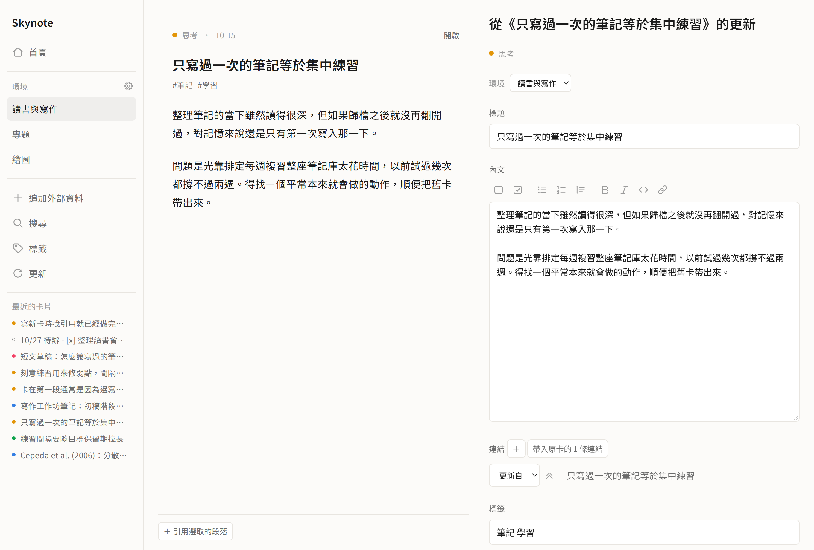
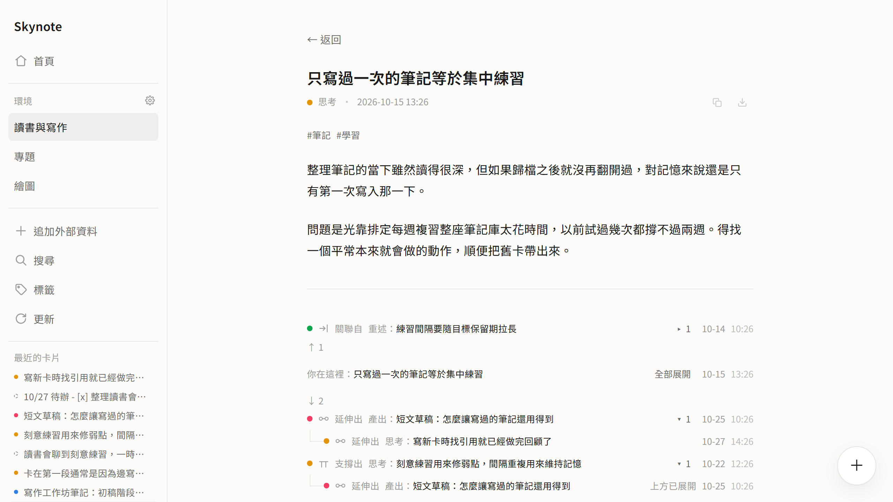

# Skynote

| 中文 | 日本語 |
|-|-|
| [繁體中文](README.md) | 現在地 |


個人用のカード型ノートシステム v3.3

1 枚のカードを 1 つの Markdown ファイルとして保存し、新しいカードから古いカードへ一方向の繋ぎを持たせる。操作手順や日々の運用は [README.md](README.md) を参照。

---

## 設計の背景

長い間、日々の着想やメモは個人用の Discord サーバーに書き留めていた。ただ、アイデアを広げていくうちに過去のメモ同士を網の目のように結びつけたくなり、チャット形式の Discord ではその構造を作りにくいことが見えてきた。そこで、1 枚を 1 つの Markdown ファイルとして保存し、「資料・言い換え・思考・断片」といった型と繋ぎによって関係づける構成を組み立てた。

設計にあたって避けたかったのが、過去のメモを延々と手入れし続けることだった。そのため、作成から 8 時間の推敲期間を過ぎるか、他のカードから参照されると編集不可になる仕組みにした。まだ整理しきれていない思いつきや誤字はすぐ手直しできる一方、確定後に考えが変わったときは新しいカードから `updates` や `refutes` で繋ぎ直す。更新に実用上の意味を持たせるため、置き換えられた古いカードは通常のタイムラインから外れ、フィルタや検索からのみ参照できる形とし、詳細画面や引用ツリー上に更新・反駁済みと示される。Notion や Obsidian のように文書を整え続ける道具ではなく、SNS のように思いついたことを気軽に投げ込みながら、型と繋ぎで思考のネットワークを編んでいく使い方を想定している。

運用を続けるうちに、Discord 上に残っていた用途をすべて同じタイムラインに混ぜると関心が散ってしまうことにも気づいた。発想のメモと日々の計画のように脈絡の異なる使い方を切り分けるため、フォルダ単位でタイムラインや検索を分けられる「環境」を導入している。

さらに運用を重ねる中で、当初の 4 つの型では公開を前提に書く文章を受け止めきれないと感じ、成果物にあたる `output` を後から追加した。また、環境を分けることでかえって思考が分断されてしまわないよう、カードの繋ぎは環境をまたいで行えるようにしている。

| 型 | 役割 | 修正・展開のしかた |
|---|---|---|
| `original`（資料） | 外部の一次資料や抜粋 | 保存し直して `updates` で繋ぐ |
| `restatement`（言い換え） | 資料を自分の言葉で整理したもの | 誤読時は新しく書き、`updates` で繋ぐ |
| `thinking`（思考） | 自分の考えや推論 | 考えが変われば `updates`、否定なら `refutes` で繋ぐ |
| `output`（成果物） | 公開を前提とした記事や草稿 | 改訂版を `updates` で繋ぐ |
| `fleeting`（断片） | ちょっとしたメモ（繋ぎなし） | 展開時に `thinking` を作り `updates` で繋ぐ |

---

## 繋ぎの語彙とデータモデル駆動の UI

カード同士の繋ぎは自由記述の参照ではなく、`part-of`（抜粋）・`about`（言及）・`related`（発展）・`supports`（根拠）・`contradicts`（対立）・`refutes`（反駁）・`updates`（更新）という閉じた 7 種類の有向語彙に限定している。同じ繋ぎでも上流・下流のどちらから読むかで言い回しが変わるようにし、詳細画面の引用ツリーを上から下へ一目で追えるようにした。また、語彙が形骸化しないよう意図的な制約も置いている。たとえば、根拠を示す `supports` は気軽なメモである `fleeting` を対象から外し、意味づけの緩い `related` は `thinking` と `output` に限定して万能の逃げ道にならないようにした。

どの型からどの型へどの繋ぎを持たせられるかは、[`src/domain/types.ts`](src/domain/types.ts) の `REL_MATRIX` に単一の対応表として定義している。サーバー側の検証、フォームの選択肢、そしてカード詳細画面の `+` ボタンから開く派生メニュー（`CARD_ACTIONS`）の三箇所すべてがこの表を参照するため、規則と UI の食い違いが起きない。新しいカードは必ず既存のカードを参照して生まれるので、作成の入口もグローバルな新規画面ではなく参照元カードの `+` に置いている。そこから開く左右参照モードの編集画面では、元のカードを左側に並べたまま、型・関係・参照先・タグが自動で入った状態で書き始められるため、利用者は裏側の制約を意識せずに思考を広げられる。

---

## システム構成とデータの一貫性

```text
GitHub (skynote-cards) ──push main──▶ GitHub Actions (typecheck / test → gcloud app deploy)

User ──Google ログイン (IAP)──▶ App Engine (asia-east1, F1, 1 台常駐)
                                  ├─ /tmp/corpus    コーパス複製（起動時 clone）
                                  ├─ /tmp/index.db  検索用索引（起動時再構築）
                   書き込み先 ────┼─▶ Cloud Storage: <PROJECT_ID>-corpus（正本）
                   非同期同期 ────┴─▶ GitHub: skynote-cards-corpus（履歴・バックアップ）
```

現在の運用環境は GCP の App Engine 上にデプロイしている。

データの正本は `cards/`（環境ごとのフォルダを含む）にある Markdown ファイルで、SQLite（`index.db`）は一覧表示と全文検索の索引として使っている。索引は削除しても再起動すれば `.md` から作り直せるため、ローカルや VM で動かす場合は手元のファイルへ直接書き込むだけで完結する。

一方、App Engine 上では `/tmp` がインスタンスの入れ替えで消えるため、書き込みの正本を **Cloud Storage** に移し、アクセス制御は IAP とアプリ側の JWT 検証で行っている。保存時はまず Cloud Storage に書き込み、成功してから `/tmp` と索引を更新して、裏側で GitHub のコーパスへ同期する。起動時や手動更新（`POST /update`）、push が競合した際には Cloud Storage と Git を突き合わせて未反映分を補い、索引を再構築する。

---

## 画面と設計・テストの記録





<sub>※ 画面の文章はデモ用のダミーデータ（UI は繁体字中国語）</sub>

MVP から v3.3 までの仕様の変遷と、途中で見送った案の理由は [`spec/README.md`](spec/README.md) を参照。ドメイン規則 `R1`–`R16`（[`src/domain/rules.ts`](src/domain/rules.ts) に対応）と UI の判断 `U1`–`U28` は、判断の経緯を追えるよう番号を振り直さずに管理している。こうした仕様やクラウド同期の突合・IAP 検証は [`test/`](test/) の自動テスト（`node --test`）でカバーしており、`main` への push 時は GitHub Actions で型チェックとテストを通った場合のみデプロイされる。

---

## 開発の分担と運用状況

要件定義・データモデル設計・アーキテクチャ設計・UI/UX の反復改善・クラウド運用設計を主導し、実装工程では AI コーディング支援を活用して開発を進めた。既存メモからの移行分と日々の記録を合わせ、現在およそ 550 枚のカードで実運用している。

---

## 技術スタックと起動方法

Node.js（`>= 22`） / TypeScript / Fastify / `better-sqlite3` / Eta / Cloud Storage / Git（App Engine・IAP・GitHub Actions）

```bash
npm install   # 依存パッケージのインストール
npm test      # 自動テストの実行
npm run dev   # 開発サーバー起動（既定：127.0.0.1:3000）
```

App Engine へのデプロイ手順と運用の詳細は [`deploy/README.md`](deploy/README.md) を参照。
