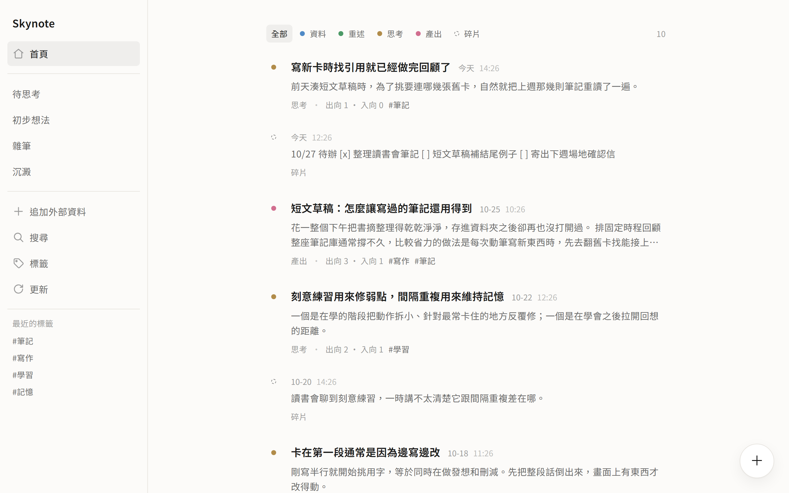
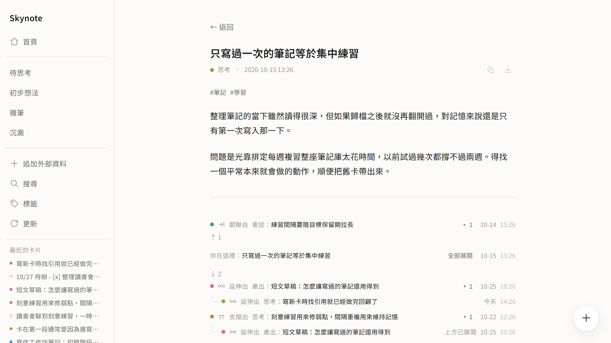

# Skynote

個人用的卡片筆記系統。每張卡片存成獨立的 Markdown 檔，卡片之間用單向連結串起來。

<!-- 文章發佈後在這裡補上連結：開發過程與設計判斷的完整說明見〈文章標題〉。 -->





<sub>截圖使用示意內容。</sub>

- **規格與設計紀錄**：[spec/](spec/README.md)。從 MVP 到 v3 共八份，也留著當時沒有採納的做法。
- **部署**：[deploy/README.md](deploy/README.md)（App Engine）。放在自己的主機上見 [deploy/vm.md](deploy/vm.md)，踩過的坑也記在那裡。

---

## 運作方式

### 檔案與索引
每張卡片就是 `cards/` 底下的一個 `.md` 檔。SQLite（`index.db`）只拿來做查詢跟全文檢索，隨時砍掉重啟就能從 `.md` 檔重算出來。存檔時只要本機檔案寫好就會回傳，Git commit 跟 push 放在背景慢慢跑。

部署在 App Engine 上時，機器的磁碟是暫時的，所以那疊 `.md` 改放在 Cloud Storage：存檔要等 bucket 回應成功才算數，機器上的 `cards/` 是開機時跟 bucket、Git 對帳出來的副本。Git 一樣在背景備份。細節見 [deploy/README.md](deploy/README.md)。

### 連結與定案
卡片照時間戳發號，連結寫在新卡上，而且只能指向已經存在的舊卡；想把兩張舊卡連起來，做法就是寫一張新卡同時指向它們。

卡片建好之後預設有 8 小時的反芻期，這段時間裡可以改內文、補連結或刪卡。過了 8 小時，或者只要有後來的卡片連向它，這張卡就定案不能再改——這樣指向某個段落的錨點（像 `#b3`）才不會因為事後改稿而跑掉。

不過有兩處例外：
- **產出（`output`）**不設時間限制，被其他卡片引用之前都能一直改稿。
- 清單開頭的 `[ ]` 與 `[x]` 不管定案了沒都能直接點，因為只換一個字元，不會動到段落順序跟錨點。

### 五種卡片型別
型別是照「這張卡寫錯的時候怎麼修」來分的：
- **資料 (`original`)**：別人寫的一手材料或文獻。抄錯或存錯時，重存一份並用 `updates` 指回。
- **重述 (`restatement`)**：用自己的話整理資料，至少要有一條 `about` 指回原資料。發現誤讀時，發一張新的重述 `updates` 指回。
- **思考 (`thinking`)**：自己的想法與推論，至少要帶一個標籤。想法改變時，發新的思考 `updates` 指回，或用 `refutes` 反駁。
- **產出 (`output`)**：寫成的文章或故事等成品。被引用之後如果要改版，就發新卡並用 `updates` 指回；連結只用 `updates` 跟 `related`。
- **碎片 (`fleeting`)**：隨手記下的一句話，不帶任何連結。之後如果想展開寫，可以發一張思考並用 `updates` 把它接起來。

### 寫卡片的入口
- **右下角隨手記**：打開只有一個文字框，打完送出就是碎片；寫到一半想寫成思考或產出，按「展開」就會把草稿帶進完整表單。
- **卡片頁的 `+` 按鈕**：讀卡片時直接從右下角的 `+` 衍生新卡，表單會自動帶入這張卡的連結與標籤，左邊也會並排顯示原卡內容方便對照。

---

## 本機開發

需要 Node.js >= 22（建議 Node 24 LTS）與 Git。

```bash
npm install                     # 安裝相依套件
npm run build                   # 編譯 TypeScript 並複製模板資源
npm test                        # 執行測試
npm run dev                     # 開發模式（預設監聽 127.0.0.1:3000）
```

環境變數（程式不會自己讀 `.env`；要嘛先 export，要嘛用 `node --env-file=.env src/server.ts` 啟動）：
- `CORPUS_PATH`：語料庫目錄路徑（裡面放 `cards/*.md`，預設 `./corpus-dev`）。
  - 同一層可以放一個選用的 `tags.yml`（跟著語料庫一起版控），把「匯入」這類出處標記擋在表單推薦與側欄最近標籤外面；標籤頁、搜尋跟手動輸入都不受影響：
    ```yaml
    locked:
      - 匯入
    ```
- `INDEX_PATH`：SQLite 索引路徑（預設 `./index.db`）。
- `PORT`：監聽埠（預設 `3000`）。
- `HOST`：監聽位址（預設 `127.0.0.1`，只有本機連得到）。
- `EDIT_WINDOW_HOURS`：反芻期小時數（預設 `8`）。

App Engine 用的設定（Cloud Storage、GitHub token、IAP）寫在 [`app.yaml`](app.yaml)，說明見 [deploy/README.md](deploy/README.md)。本機不設它們，行為就跟以前一樣：本機檔案是真相。

---

## 部署與維運

正式環境在 Google App Engine（`asia-east1`），透過 IAP 只讓自己的 Google 帳號登入。push 到 `main` 之後，GitHub Actions 先跑測試，過了才部署；只改文件不會觸發。從零開始的設定步驟見 [deploy/README.md](deploy/README.md)。

```
Cloud Storage：<專案 ID>-corpus     ← 卡片的唯一真相
GitHub：skynote-cards-corpus        ← 備份與歷史（私有 repo）
App Engine 的 /tmp/corpus、index.db ← 開機時對帳出來的副本與索引
```

| 動作 | 指令 / 入口 |
|---|---|
| **查看即時日誌** | `gcloud app logs tail -s default` |
| **健康檢查** | 登入後開 `/_health` |
| **換一台機器（等於重開）** | `gcloud app instances delete <ID> --service=default --version=<版本>` |
| **切回上一版** | `gcloud app services set-traffic default --splits=<上一版>=1` |
| **取回遠端語料庫並重建索引** | 側欄的「更新」（`POST /update`） |

如果在別處的 clone 手動改了卡片檔或 `tags.yml` 並 push 上去，按一下側欄的「更新」：系統會先補上還沒 commit 的卡片、跑 `git pull --rebase`、跟 bucket 對帳（取回來的修改傳上 bucket）、把本機領先的 commit 推回去，最後重建索引。遇到衝突就直接放棄這次取回，不會把語料庫弄髒。重建後的報告也會列出有沒有因為手改而違反規則的卡片或壞連結。

想放在自己的機器上（VM、家裡的小主機），照 [deploy/vm.md](deploy/vm.md)：不設 Cloud Storage，本機檔案就是真相，對外改用 Cloudflare Tunnel 與 Access。
